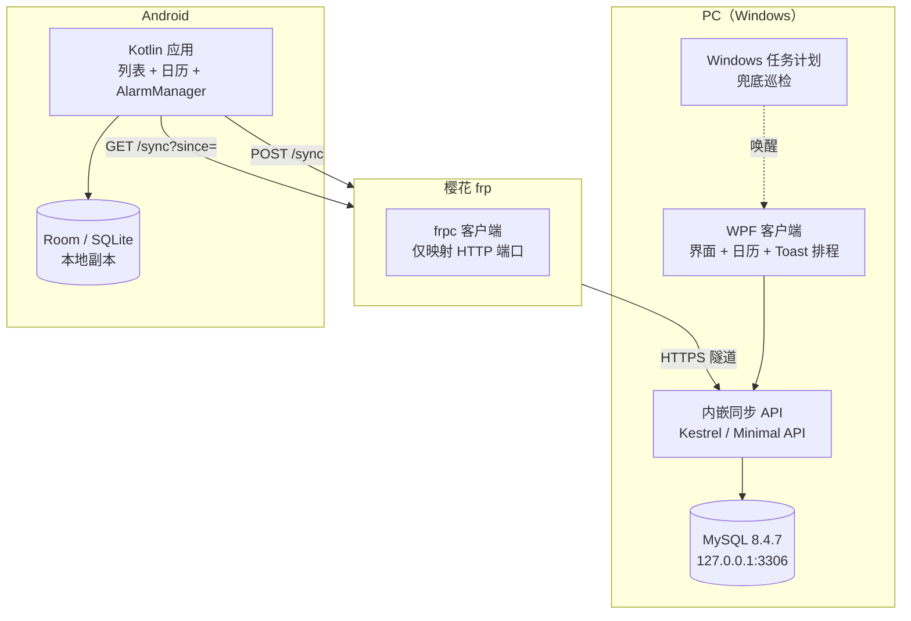
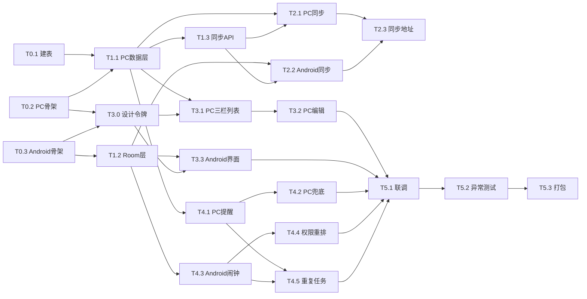

# 滴答双端（PC + Android）开发计划书

| 项目 | 内容 |
|---|---|
| 版本 | v1.6（PC 端出 MSI 安装包） |
| 日期 | 2026-11-13 |
| 依据 | 本项目需求与实施记录 |
| 定位 | 自建轻量待办提醒应用，不追求功能对齐原版，只保证「记得住、叫得醒、能同步」 |
| 代码状态 | PC 端已完成地基 / 数据层 / 同步 / 界面 / 提醒；Android 端已完成骨架 / 数据层 / 同步 / 系统日历读写（单向写入），真机与 PC 双向同步实测通过 |

---

## 1. 目标与范围

### 1.1 产品目标

一个只给自己用的待办 + 闹钟 + 日历应用，PC 与 Android 双端，数据以**电脑本地 MySQL**为主库。同步优先走**局域网直连**（手机填电脑地址即可），需要在家门外同步时再加 frp 穿透。

核心诉求排序（不可妥协）：

1. **提醒必须准**——到点必须响，断网、frp 掉线、服务器不可达都不能漏。
2. **数据不能丢**——双端各自本地都有完整副本，任何一端失联不影响另一端使用。
3. **同步可以慢**——手动触发或后台轮询即可，不做实时推送。

### 1.2 MVP 功能边界

**必须做（P0）**

| 功能 | 说明 |
|---|---|
| 待办 CRUD | 标题、备注、截止时间、提醒时间、完成状态 |
| 年月日日历 | 按 `due_at` 分组渲染，月视图为主 |
| 本地提醒 | 到点弹通知 + 响铃；PC 用 Windows Toast，Android 用系统通知 |
| 重复任务 | 每天 / 每周 / 每月 / 每年 / 每个工作日 / 每 N 天（不含完整 RRULE） |
| 双端同步 | 手动「立即同步」+ 启动时同步 |
| 删除同步 | 墓碑删除，不能因为一端删除就被另一端复活 |
| 离线可用 | 断网时全部功能正常，仅同步按钮置灰 |

**明确不做（本期）**

- 多人协作、分享清单、团队空间
- 富文本备注、附件、子任务嵌套
- 番茄钟、习惯打卡、专注统计
- 自然语言解析（「明天下午三点」）
- iOS / macOS / Web 端
- 实时推送（WebSocket / MQTT）

### 1.3 设计铁律

违反以下任一条即视为方案错误：

1. **提醒由客户端本地排程**。服务器/MySQL 永远不负责「到点响」。断网、frp 掉线、PC 关机都不影响手机和 PC 各自的提醒。
2. **MySQL 3306 绝不暴露公网**。frp 只映射一个 HTTP API 端口，且必须带密钥校验。
3. **同步是非实时的**。不做长连接，不做推送，只做拉取 + 推送。
4. **每端都有完整数据副本**。同步失败不阻塞使用。
5. **所有时间以 UTC 毫秒存储**，展示与提醒按设备本地时区换算。

### 1.4 验收标准

MVP 通过的判定条件（全部满足）：

- [ ] PC 端创建任务 → 手动同步 → Android 端拉取后可见，字段一致
- [ ] Android 端创建任务 → 同步 → PC 端可见
- [ ] 一端删除任务 → 另一端同步后消失，且不会再次出现
- [ ] PC 端设 2 分钟后提醒，锁屏状态下准时弹出系统通知
- [ ] Android 端设 2 分钟后提醒，息屏状态下准时通知 + 响铃
- [ ] 手机关机重启后，未触发的提醒仍会按时响（重排生效）
- [ ] PC 端断网 30 分钟后恢复，一次同步能补齐全部变更
- [ ] 两端同时修改同一任务，同步后取「更新时间更晚」的版本，不冲突报错
- [ ] 连续运行 72 小时无漏提醒、无数据错乱

---

## 2. 架构设计

### 2.1 总体架构



**关键点**：手机端只依赖「HTTP 可达」这一个条件；同步不通时，APP 完全靠本地 SQLite 正常工作。PC 端同理，即使 frpc 没启动也能用。

### 2.2 组件职责

| 组件 | 职责 | 明确不负责 |
|---|---|---|
| WPF 客户端 | 界面、日历渲染、本地提醒排程、触发同步 | 不做网络监听以外的服务发现 |
| 内嵌 API | 处理 `GET/POST /sync`、鉴权、rev 递增、写 MySQL | 不主动推送、不发通知 |
| MySQL | 唯一权威数据源、rev 单调递增 | 不做定时任务 |
| Windows 任务计划 | 应用被关闭/崩溃时唤醒它补发漏掉的提醒 | 不直接弹通知 |
| Android APP | 列表/日历、AlarmManager 精确排程、本地 SQLite、同步 | 不依赖服务器做提醒 |
| frpc | 把 PC 的 API 端口映射到公网 | 不映射 3306 |

### 2.3 数据流

**同步上行（本地 → 服务端）**

```
本地 task 表 (dirty=1)
  → 组装 JSON 批次（≤200 条）
  → POST /sync  { changes: [...] }
  → 服务端逐条比对 rev，写库并 rev+1
  → 返回 { accepted: [{id, rev}], server_time }
  → 本地把 dirty 置 0，写入新 rev
```

**同步下行（服务端 → 本地）**

```
本地保存 last_cursor（上轮最大 rev）
  → GET /sync?since=last_cursor
  → 服务端返回 rev > since 的全部行（含 deleted=1 墓碑）
  → 本地按 id upsert；本地有未提交修改时比较 updated_at
  → 更新 last_cursor = 返回的 max_rev
```

**登录（手机端，PC 端回环直连不需要）**

```
用户名 + 密码 → POST /login { name, password }
  → 服务端 PBKDF2-SHA256 校验，生成 32 字节随机 token 并落库
  → 返回 { token, name }
  → 之后 /sync 请求都带 X-Token
改密码时清空 token，旧登录立即失效
```

### 2.4 部署拓扑

- MySQL：`127.0.0.1:3306`，`bind-address=127.0.0.1`，服务名 `MySQL84`，**手动启动**
- 内嵌 API：`127.0.0.1:5080`，跟随 WPF 进程生命周期
- frpc：映射 PC 的 `5080` → 樱花分配的域名/端口，走 HTTPS
- 鉴权：手机端先 `POST /login` 换 `X-Token`（用户名 + 密码，账号只存在 PC 的 MySQL）；本机回环请求免鉴权

---

## 3. 数据模型

### 3.1 服务端（MySQL）

```sql
CREATE TABLE task (
  id          CHAR(26)     NOT NULL COMMENT 'ULID，双端生成，全局唯一',
  title       VARCHAR(255) NOT NULL,
  note        TEXT         NULL,
  location    VARCHAR(255) NULL COMMENT '地点，可为空',
  start_at    BIGINT       NULL COMMENT 'UTC 毫秒，起始时间',
  due_at      BIGINT       NULL COMMENT 'UTC 毫秒，截止时间',
  all_day     TINYINT(1)   NOT NULL DEFAULT 0 COMMENT '全天事件，只取日期',
  remind_at   BIGINT       NULL COMMENT 'UTC 毫秒，为空则用 start_at / due_at',
  repeat_rule VARCHAR(32)  NULL COMMENT 'none|daily|weekly|monthly|yearly|weekday|every:N',
  done        TINYINT(1)   NOT NULL DEFAULT 0,
  deleted     TINYINT(1)   NOT NULL DEFAULT 0 COMMENT '墓碑标记',
  updated_at  BIGINT       NOT NULL COMMENT 'UTC 毫秒，冲突裁决依据',
  rev         BIGINT       NOT NULL COMMENT '服务端单调递增版本号',
  PRIMARY KEY (id),
  KEY idx_rev (rev),
  KEY idx_start (start_at),
  KEY idx_due (due_at)
) ENGINE=InnoDB DEFAULT CHARSET=utf8mb4 COLLATE=utf8mb4_0900_ai_ci;

CREATE TABLE sync_meta (
  k VARCHAR(32) PRIMARY KEY,
  v BIGINT NOT NULL
);
INSERT INTO sync_meta (k, v) VALUES ('rev_seq', 0);

-- 同步账号：单用户（id 固定 1），手机端用「用户名 + 密码」换 token
CREATE TABLE app_user (
  id         TINYINT     NOT NULL PRIMARY KEY,
  name       VARCHAR(64) NOT NULL,
  salt       VARCHAR(32) NOT NULL,
  hash       VARCHAR(64) NOT NULL COMMENT 'PBKDF2-SHA256 派生值，Base64',
  token      VARCHAR(64) NULL     COMMENT '手机登录后换到的凭证，改密码时清空',
  updated_at BIGINT      NOT NULL
) ENGINE=InnoDB DEFAULT CHARSET=utf8mb4 COLLATE=utf8mb4_0900_ai_ci;
```

`rev` 由服务端在事务内 `SELECT ... FOR UPDATE` 递增，保证多端并发时顺序唯一。

### 3.2 客户端（两端同构）

```sql
CREATE TABLE task (
  id          TEXT PRIMARY KEY,
  title       TEXT NOT NULL,
  note        TEXT,
  location    TEXT,
  start_at    INTEGER,
  due_at      INTEGER,
  all_day     INTEGER NOT NULL DEFAULT 0,
  remind_at   INTEGER,
  repeat_rule TEXT,
  done        INTEGER NOT NULL DEFAULT 0,
  deleted     INTEGER NOT NULL DEFAULT 0,
  updated_at  INTEGER NOT NULL,
  rev         INTEGER NOT NULL DEFAULT 0,
  dirty       INTEGER NOT NULL DEFAULT 0   -- 仅客户端：待上传
);
CREATE INDEX idx_task_rev ON task(rev);
CREATE INDEX idx_task_start ON task(start_at);
CREATE INDEX idx_task_due ON task(due_at);
```

老库升级用幂等补列（`PRAGMA table_info(task)` 检测缺失列后 `ALTER TABLE ADD COLUMN`），不做物理重建。

### 3.3 字段约定

| 字段 | 约定 |
|---|---|
| `id` | ULID 字符串（26 位），客户端生成，天然按时间排序，免去自增冲突 |
| `start_at` / `due_at` / `remind_at` | UTC 毫秒；展示时用设备时区换算 |
| `all_day` | 全天事件：`start_at`/`due_at` 只取当天 00:00，列表展示「全天」而非时刻 |
| `anchor_at` | 派生值 `start_at ?? due_at`，列表排序与日历归位统一用它 |
| `remind_at` 为空时 | 依次回退 `start_at` → `due_at` |
| `repeat_rule` | 受控字符串，见 3.4 编码表；不解析标准 RRULE |
| `deleted` | 墓碑。删除 = 置 1 + 更新 `updated_at`，**永不做物理删除** |
| `updated_at` | 修改瞬间的 UTC 毫秒，冲突裁决唯一依据 |
| `rev` | 服务端权威版本号，客户端只读 |

### 3.4 重复规则编码

`repeat_rule` 存受控字符串，两端共用同一套推导函数，**不解析标准 RRULE**。

| 编码 | 含义 | 下一次时间推导 |
|---|---|---|
| `none` | 不重复 | 无 |
| `daily` | 每天 | 基准日 +1 天 |
| `weekly` | 每周 | 基准日 +7 天 |
| `monthly` | 每月 | 同一天的下个月；该月无此日时取该月最后一天（如 1/31 → 2/28） |
| `yearly` | 每年 | 同年同月同日；2/29 遇平年取 2/28 |
| `weekday` | 每个工作日 | 从基准日往后找第一个周一至周五 |
| `every:N` | 每 N 天（N 为 2–365 的整数） | 基准日 + N 天 |

约定：

- 推导基准是**本次触发时间**，不是创建时间，避免「补发后连跳」
- 推导结果若早于当前时刻（设备休眠数天），循环推导直到落在未来
- 推导后同时更新 `due_at` 与 `remind_at`，两者保持原有偏移量
- `every:N` 的 N 解析失败时按 `none` 处理，不抛异常

### 3.5 闹钟（alarm）

独立闹钟与任务提醒分开：任务提醒由 `remind_at` 驱动，闹钟只按「时:分」在**本机**响，不依赖任何任务。

```sql
CREATE TABLE alarm (
  id            TEXT PRIMARY KEY,
  label         TEXT,
  hour          INTEGER NOT NULL,               -- 用户输入的本地时刻 0–23
  minute        INTEGER NOT NULL,               -- 用户输入的本地时刻 0–59
  repeat_rule   TEXT NOT NULL DEFAULT 'daily',  -- once / daily / weekday
  once_at       INTEGER,                        -- 仅 once：UTC 毫秒
  enabled       INTEGER NOT NULL DEFAULT 1,
  last_fired_at INTEGER,                        -- 本机上次响铃时刻，防重复触发
  deleted       INTEGER NOT NULL DEFAULT 0,
  updated_at    INTEGER NOT NULL,
  rev           INTEGER NOT NULL DEFAULT 0,
  dirty         INTEGER NOT NULL DEFAULT 0
);
```

约定：

- `hour` / `minute` 是**墙上时间**，直接存用户输入的本地时刻，不做 UTC 换算。这是对 3.3 时间约定的一处显式例外：重复闹钟要跟着设备时区走，存 UTC 会导致跨时区后 07:00 变成别的点
- `once_at` 是真正的 UTC 毫秒，仅 `once` 使用；响过后置 `enabled = 0`
- `last_fired_at` 用于本机调度去重（同一天只响一次），参与同步但不参与冲突裁决
- 同步字段与任务一致（墓碑 `deleted` / `updated_at` / `rev` / `dirty`），复用 4.1 的 `/sync` 通道，载荷字段名 `alarms`
- **闹钟只来自「闹钟」页**：`/sync` 的 `alarms` 只取 PC 本地 `alarm` 表（`deleted = 0`），任务提醒、从系统日历导入的日程（`C` 开头 id）一律不进这个字段；手机端整批替换本地 `alarm` 表，只读展示
- 「稍后 9 分钟」不新增字段：插入一条 `once` 闹钟，复用同一套调度

---

## 4. 同步协议

### 4.1 接口契约

**`GET /sync?since={rev}`**

```json
// 200 OK
{
  "server_time": 1762750000000,
  "max_rev": 1287,
  "tasks": [
    {
      "id": "01JC8Z3K7M9PQR2TVXWY5N4ABC",
      "title": "交房租",
      "note": null,
      "due_at": 1762790400000,
      "remind_at": 1762786800000,
      "repeat_rule": "monthly",
      "done": 0,
      "deleted": 0,
      "updated_at": 1762700000000,
      "rev": 1285
    }
  ],
  "alarms": [
    {
      "id": "01JC9B2M4N6PQR8STVWX0Y1ZAB",
      "label": "站会",
      "hour": 9,
      "minute": 30,
      "repeat_rule": "weekday",
      "once_at": null,
      "enabled": true,
      "last_fired_at": null,
      "deleted": false,
      "updated_at": 1762700000000,
      "rev": 12,
      "dirty": false
    }
  ]
}
```

`alarms` 每次同步都整批返回（闹钟数量少，不做增量游标）；手机端用整批替换，不做冲突裁决。

**`POST /sync`**

```json
// 请求
{
  "since": 1280,
  "changes": [ { "id": "...", "title": "...", "...": "...", "rev": 1283 } ]
}

// 200 OK
{
  "server_time": 1762750001000,
  "max_rev": 1290,
  "accepted": [ { "id": "01JC8Z...", "rev": 1288 } ],
  "rejected": [ { "id": "01JC9A...", "reason": "stale", "server": { /* 服务端当前版本 */ } } ],
  "tasks": [ /* 同 GET，返回 since 之后的全部变更 */ ],
  "alarms": [ /* 同 GET，电脑端「闹钟」页的完整列表 */ ]
}
```

设计取舍：`POST` 同时承担「推」和「拉」，减少一次往返；手机端一次同步只发一个请求。

### 4.2 冲突解决

规则按优先级：

1. **同 id 比 `updated_at`**，大者胜；相等则比 `rev`，大者胜；再相等则保留服务端（幂等）。
2. **删除优先**：`deleted=1` 的一方只要 `updated_at` 不早于对方，就压过对方的编辑。避免「删了又活」。
3. **`accepted` / `rejected` 都带回服务端版本**，客户端无条件覆盖本地，保证最终一致。

### 4.3 时钟与乱序

- 手机与 PC 时钟可能差几分钟，因此**不以客户端时间做「谁更新」的唯一依据**：服务端会记录 `received_at`，当 `updated_at` 与 `received_at` 偏差超过 10 分钟时，用 `received_at` 作为兜底。
- `rev` 单调递增，`since` 游标只会前进，天然抵抗乱序与重放。

### 4.4 同步触发时机

| 触发点 | 说明 |
|---|---|
| 应用启动 | 一次全量增量同步；PC 端先渲染列表与日历，内嵌同步服务与首次同步推迟到首帧之后，避免冷启动被网络与 Kestrel 拖慢 |
| 手动点击「同步」 | 立即执行，结果显示「已同步 N 条」 |
| 前台每 15 分钟 | 仅当用户停留在详情/列表页时 |
| 后台周期 | Android 用 WorkManager（最小 15 分钟）；PC 用 30 分钟定时器 |
| 应用进入后台前 | 尽力推送一次，避免丢弃 |

---

## 5. 提醒引擎

### 5.1 PC 端

**排程方式**

- 常驻托盘，`DispatcherTimer` 每 30 秒扫一次「未来 2 分钟内到点」的任务
- 命中后用 `Microsoft.Toolkit.Uwp.Notifications` 发 Toast（已确认 AUMID 注册方式需在安装时写开始菜单快捷方式）
- 同时播放提示音（`RemindSound` 目录下的 wav/mp3）

**漏提醒兜底（关键）**

- 安装时注册 Windows 任务计划：每 5 分钟触发一次，参数 `/check-missed`
- 应用启动时立即扫「`remind_at` 已过但未标记已提醒」的任务，补发并标记
  - 只补发**当天**漏掉的：昨天及更早到点的提醒不再弹，避免新补录的历史日程一同步进来就连环提醒
- 新增字段 `reminded_at`，避免重复弹窗

**系统休眠**

监听 `SystemEvents.PowerModeChanged`，恢复时立刻补扫。

### 5.2 Android 端

**排程方式**

- `AlarmManager.setAlarmClock()` + `PendingIntent` + `BroadcastReceiver`（有精确闹钟权限时；无权限退化为 `setAndAllowWhileIdle`）
- 每个任务一个 `requestCode`（用 id 的 hash），便于取消
- 触发 → 发通知 + 响铃（`NotificationChannel` 重要性设为 HIGH）
- 实测：小米 HyperOS 会推迟 `setExactAndAllowWhileIdle`，息屏时直到亮屏才补发；换成「闹钟」类型后息屏也能准点触发

**权限矩阵（必须全部处理）**

| 版本 | 权限 | 处理 |
|---|---|---|
| Android 12+ | `SCHEDULE_EXACT_ALARM` | 引导用户到系统设置开启，检测失败时降级为 `setAndAllowWhileIdle` 并提示 |
| Android 13+ | `POST_NOTIFICATIONS` | 运行时请求 |
| Android 6+ | 电池优化白名单 | 引导加入 `REQUEST_IGNORE_BATTERY_OPTIMIZATIONS` |
| 全部 | `RECEIVE_BOOT_COMPLETED` | 重启后重排全部未来提醒 |

**重排策略**

`BOOT_COMPLETED` / 应用升级 / 时区变化 / 时间被修改 → 清空全部 Alarm 并按本地库重排。这是防漏提醒的核心。

### 5.3 双方共同规则

- `remind_at` 为空时用 `due_at`
- 重复任务：触发后按 3.4 编码表推导下一次时间，写入新的 `remind_at` 与 `due_at` 并重新排程
- 工作日规则在周六/周日触发时，直接跳到下周一，不在周末响
- 已完成（`done=1`）或已删除（`deleted=1`）的任务不排程
- **提醒不依赖网络**：排程数据全部来自本地库

---

## 6. 界面设计规范

> 定位：**布局与交互学滴答，配色与字体自定义**。
> 布局依据来自 PC 报告 4.2（视图模块）与 4.8（视觉风格判断）、Android 报告 7.2（主题化控件思路）与 7.4（页面清单）；只取结构与手势，不复刻视觉。
> 明确不做：看板 / 时间线 / 四象限 / 清单树 / 标签 / 番茄钟 / 习惯打卡 / Markdown 编辑器。理由见 1.2。

### 6.1 设计原则

1. **一屏原则**：PC 最多三栏，Android 单页 + 一个底部弹层，不引导航。
2. **令牌唯一来源**：所有颜色、圆角、间距、字号来自 6.2 的令牌表，代码里禁止出现十六进制字面量。
3. **任务只有一行**：勾选框最左，依次是开始时间、主题、地点、截止时间，五栏紧挨排列；主题、地点超宽省略，多余空白留在最右侧。
4. **动效只服务于状态变化**：勾选、完成移出、面板滑入、提醒弹出、删除消散，五处；不做装饰性动画。
5. **深浅双主题等价**：暗色不是简单反色，按 6.2 的深色列单独取值。

### 6.2 设计令牌（tokens）

颜色：

| Token | 浅色 | 深色 | 用途 |
|---|---|---|---|
| `bg-app` | `#F7F8F8` | `#16171A` | 窗口底色、列表背景 |
| `bg-surface` | `#FFFFFF` | `#1F2126` | 卡片、侧栏、弹层 |
| `bg-hover` | `#F0F2F2` | `#262930` | 悬停 / 选中行 |
| `text-primary` | `#1B1D1F` | `#E8EAED` | 任务标题、正文 |
| `text-secondary` | `#6B7075` | `#9AA0A6` | 日期、分组头、说明 |
| `text-tertiary` | `#A0A5AA` | `#6B7075` | 占位符、禁用 |
| `line` | `#E6E8EA` | `#2C2F36` | 分割线、卡片描边 |
| `accent` | `#2E9E75` | `#3FB98D` | 主行动点、选中态、复选框填充 |
| `accent-weak` | `#E6F4EF` | `#1E3A31` | 今日高亮底、选中胶囊底 |
| `danger` | `#E05B4C` | `#F07167` | 逾期文字、删除 |
| `warning` | `#E0A030` | `#E8B44C` | 即将到期（24 小时内） |

尺寸与排版：

| 类别 | 取值 |
|---|---|
| 圆角 | `4`（小标签）/ `8`（卡片、输入框）/ `12`（弹层）/ `999`（胶囊、复选框） |
| 间距 | `4 / 8 / 12 / 16 / 24`（4 的倍数，不出现 5、10、15） |
| 字号 | `11`（辅助）/ `12`（日期）/ `13`（列表标题）/ `14`（正文）/ `16`（栏标题）/ `20`（页面标题）/ `28`（月份大字） |
| 行高 | 字号 × 1.4 |
| 字重 | 常规 400；今日日期、选中的分组头用 600 |
| 字体 | PC：`Microsoft YaHei UI`；Android：系统默认（Noto Sans CJK）。所有数字走**等宽数字**（tabular numerals），见 6.7 ② |
| 阴影 | 仅浮层：`0 4 16 rgba(0,0,0,.08)`（深色主题 `rgba(0,0,0,.40)`） |
| 图标 | 线性，1.5px 描边，尺寸 `16 / 20 / 24`；用系统字体图标或手绘 Path，不引图标库 |

### 6.3 PC 布局（WPF）

三栏固定结构，窗口最小 `900 × 600`，默认 `1100 × 720`。

```
┌─────────────────┬────────────────────────────────┬───────────────────┐
│  ‹  2026年11月  ›│ 今天 11月10日 周二    [日|周|月] │  新建任务          │
│  一 二 三 四 五…│  · 3 项未完成       [同步][+ 添加]│  主题 ___________  │
│  ┌───────────┐  │  ┌──────────────────────────┐  │  地点 ___________  │
│  │ 月历 34×34 │  │  │ ○  写周报          18:00 │  │  ☐ 全天事件        │
│  └───────────┘  │  └──────────────────────────┘  │  起始 2026-11-10   │
│                 │  ┌──────────────────────────┐  │  截止 2026-11-10   │
│  ▸ 今天      3  │  │ ○  整理桌面         全天 │  │  重复 [不重复  ▾]  │
│  ▸ 全部     12  │  └──────────────────────────┘  │  正文              │
│  ▸ 已完成   48  │                                │  [保存]   [删除]   │
└─────────────────┴────────────────────────────────┴───────────────────┘
    272px 侧栏               自适应主区                  340px 详情
```

| 区域 | 规格 |
|---|---|
| 侧栏 | 宽 `272`，背景 `bg-surface`；上部迷你月历（单元格 `34×34`，今日 `accent-weak` 底 + `accent` 字，有任务加小圆点），下部三个入口（今天 / 全部 / 已完成），右侧显示计数 |
| 主区顶栏 | 高 `56`：左侧标题 `20` 号 + 副标题 `12` 号；右侧依次为「日 / 周 / 月」分段、`同步`、`+ 添加`（`PrimaryButton`，主色填充） |
| 视图切换 | 分段按钮三选一，选中态只由 ViewModel 决定（`accent` 底 + `on-accent` 字）；`日` = 今天/指定日，`周` = 周一起 7 组，`月` = 6×7 网格 |
| 主区列表 | 列表行高 `44`，左右内边距 `16`，行间无分割线，悬停整行 `bg-hover`；周视图每天一组，空组显示「暂无安排」`text-tertiary` |
| 月视图 | 6 行 × 7 列，行高与每日显示上限随可用高度动态计算（`row = (可用高 − 星期行) / 6`，`limit = ⌊(row − 27) / 19⌋`，`limit` 夹在 1–12）；格内日期 `12` 号 + 任务条（`11` 号，`accent-weak` 底），不显示 `+N`；仅当该周任意一天任务数超过 `limit` 时，该行左侧 `22` 宽处出现黑色「展」，点击后整行 7 天一起向下展开为全部任务、按钮变「收」，再点收起；展开 / 收起时整行高度与格内条目区高度同步缓动 `220ms` `CubicEase EaseOut`，多出的条目靠裁剪区逐条揭开 / 遮住（条目集合不重建，所以不闪），单周与「展开全部」走同一套过渡；顶栏在月视图下额外出现「展开全部 / 收起全部」，一次切换所有可展开的周（全部展开后文案自动变「收起全部」）；行数超出视口时月网格整体垂直滚动 |
| 任务行 | `[复选框 18] [标题 flex] [日期 12号字 text-secondary]`；全天事件显示「全天」且不因当天 00:00 已过标红；逾期用 `danger`，24 小时内用 `warning`；对齐细则见 6.7 |
| 详情面板 | 宽 `340`，默认隐藏；选中任务或点「+ 添加」后从右侧滑入（`200ms` `CubicEase`），带左描边 `line`；标题为「任务详情」或「新建任务」 |
| 详情字段 | 纵向顺序固定：主题 → 地点 → 「全天事件」勾选 → 起始日期 + 时间 → 截止日期 + 时间 → 重复 → 正文；勾选全天时时间输入置灰不可用；内容区放 `ScrollViewer` 以适配 600 高窗口；底部「保存 / 删除」，标题为空时保存禁用 |
| 快速创建 | 不再有底部常驻输入条；新建统一走上表右上角 `+ 添加`（`Ctrl+N` 等效） |

### 6.4 Android 布局（同步面板，原生 View）

手机端不做任务编辑，只做同步控制台：把本地改动推到电脑、把电脑的改动拉回来，并列出这一次具体动了哪些条目。界面全部用原生 View 构建，零第三方依赖。

```
┌─────────────────────────┐
│ 滴答               [设置] │
│ 已登入：dida · 本地 55 条 │
│                         │
│ [仅上传] [仅下载] [同步]  │
│                         │
│ 上传 2 条，下载 3 条      │
│ ↑ 写周报                │
│ ↓ 交房租                │
│ × 买牛奶（电脑端已删）    │
└─────────────────────────┘
```

| 区域 | 规格 |
|---|---|
| 顶栏 | 「滴答」`22sp` 加粗，右侧「设置」按钮 |
| 状态行 | `12sp` 深灰：登入状态 + 本地条数；提醒权限未开全时多一行橙色提示，点进设置 |
| 动作行 | 三个等宽按钮：仅上传 / 仅下载 / 同步；执行中全部置灰，避免并发 |
| 结果区 | `13sp` 摘要一行（上传 / 下载 / 删除条数），下方逐条列出本次变化：`↑` 新上传、`↓` 新下载、`×` 服务端删除、`↺` 冲突被拒（已改用电脑版本）；最多列 60 条，超出显示「…还有 N 条」 |
| 设置页 | 服务器地址 + 用户名 + 密码 + 登入 / 登出；提醒权限四项（通知 / 精确闹钟 / 电池白名单 / 锁屏全屏提醒）；读系统日历；只读说明 |

### 6.5 关键交互（对齐滴答）

| 动作 | PC | Android | 细节 |
|---|---|---|---|
| 勾选完成 | 点复选框 | — | 圆环回弹：先压到 `0.72`（`90ms`）再带回弹复位（`360ms`）；对勾从左下起笔一笔写到右上（`240ms`）；同时 8 枚 `3px` 粒子沿八个方向飞出 `15` 并淡出（`420ms`）；随后标题划线并转 `text-tertiary` |
| 完成移除 | 停留 2s 后行高塌陷 `200ms` | — | 期间该行显示「撤销」，点即恢复 |
| 一键完成 | 右上角「完成逾期（n）」/「完成本日（n）」 | — | 今天、全部视图先清逾期；没有逾期或处于日/周/月/年视图时清选中日。重复任务推进到下一次；2 秒内可整体撤销 |
| 快速添加 | 点右上角「+ 添加」→ 右侧表单 | — | PC 表单含主题 / 地点 / 全天 / 起始 / 截止 / 重复 / 正文；日期留空时归入「无日期」 |
| 删除 | 详情面板「删除」 | — | 删除写墓碑（`deleted=1`），不物理删；PC 端按钮先散成粒子，随后面板滑出与列表行消散同时进行，下方日程果冻回弹 |
| 改重复任务 | 弹窗三选一 | — | 「仅本次 / 本次及以后 / 全部」，与滴答文案一致 |
| 提醒弹出 | Windows Toast，点击打开对应详情 | 全屏提醒 Activity | 操作按钮：完成 / 推迟 10 分钟 / 推迟 1 天 |
| 同步 | 右上角「同步」按钮 + `Ctrl+R` | 首页「仅上传 / 仅下载 / 同步」三个按钮 | 执行中三个按钮一起置灰；结束后摘要一行 + 逐条列出本次新上传 / 下载 / 删除的条目 |
| 键盘快捷操作 | 鼠标在左面板：`←/→` 前后一天、`↑/↓` 前后一周（`A/D/W/S` 等效）；鼠标在主面板：`↑/↓` 选日程、`Enter` 完成、`Delete` 删除 | — | 删除要按 `Enter` 确认、`Esc` 取消；输入框里打字时不抢按键 |
| 开机自启 | 登录 Windows 后带 `--tray` 静默启动，只进托盘不弹窗；设置里可关 | — | 写当前用户 `Run` 项指向运行中的 exe；单实例保证之后双击图标只唤醒窗口（实测约 0.26s） |

### 6.6 状态与空态

| 状态 | 表现 |
|---|---|
| 结果区为空 | 「这次没有新增或变化的条目」`12sp` 灰字 |
| 同步中 | 三个动作按钮置灰，摘要显示「同步中…」 |
| 同步失败 | 摘要红字「失败：…」，数据仍保存在本地 |
| 权限未授予（Android） | 主页面橙色提示「提醒权限未开全 · 点这里去设置」；设置页三项逐项可跳系统设置 |
| 首次启动 | 不做引导动画，直接进同步面板 |

### 6.7 文本与视觉对齐

文本不是浮在控件上的，必须与控件共享同一套对齐基准。以下为硬性规范，不靠肉眼调。

**① 基线对齐**

| 场景 | 做法 |
|---|---|
| 同一行内多段文字 | 共用一条基线；PC 用 `BaselineAlignment`，Compose 用 `Modifier.alignByBaseline()` |
| 文字与图标同行 | 图标按 `Center` 对齐文字行的视觉中心，文字走基线；禁止用 `Padding.Top` 目测下移 |
| 文字与复选框 | 复选框垂直居中于整行，标题基线居中；偏差 ≤ `1px` |

同行的垂直居中一律由容器（行高 + `Center`）决定，禁止在文字上加 `Margin` 顶位置。

**② 数字对齐**

- 所有时间、日期、计数使用**等宽数字**：WPF `Typography.NumeralAlignment="Tabular"`；Compose `fontFeatureSettings = "tnum"`。
- 列表右侧时间列**定宽**（PC `64px`／Android `56dp`）且右对齐，冒号落在同一竖线上，扫视时成列。
- 侧栏计数（今天 `3`、全部 `12`）右对齐到同一列，禁止用空格凑齐。
- 周条/月历单元格内数字居中，等宽后仍居中。

**③ 控件间距**

| 关系 | 间距 |
|---|---|
| 复选框 → 标题 | `8` |
| 标题 → 时间 | 弹性填充，不写死宽度 |
| 图标 → 文字 | `8` |
| 字段标签 → 字段值（详情面板） | `12` |
| 同一行内两个按钮 | `8` |

间距只能取自 6.2 的间距刻度，不允许出现 `5 / 10 / 15`。

**④ 行内垂直居中**

- PC 行高 `44`、Android 行高 `56`，文字与复选框都对齐到行中心。
- 输入框与按钮同行时等高；同一行的控件顶边、底边各自对齐。
- 详情面板字段行高 `48`，标签与值同一基线。

**⑤ 文本长度与截断**

| 对象 | 规则 |
|---|---|
| 任务标题 | 单行；超长省略号（WPF `TextTrimming="CharacterEllipsis"`／Compose `maxLines = 1, overflow = Ellipsis`） |
| 时间 / 日期 | 不截断，定宽容纳 `HH:mm` 与 `MM-dd` 两种最长形态 |
| 分组头 / 侧栏入口 | 不换行、不截断；文案超长改文案，不改布局 |
| 备注 | 列表内不显示；详情面板内多行，超出滚动 |
| 次日/全天标记 | 「全天」与 `HH:mm` 共用同一区域，字号不变 |

**⑥ 中英混排**

- 中文用全角标点，英文与数字用半角，同一句内不混用。
- 数字与英文单词前后不手动加空格，交给排版引擎。
- 字号不随语言变化，同一元素在两端字号映射关系固定（见 6.2）。
- 文案两端**逐字一致**（同一功能同一措辞），不允许一端「推迟 10 分钟」另一端「稍后提醒」。

**⑦ 两端度量对照**

| 度量 | PC | Android |
|---|---|---|
| 列表行高 | `44` | `56` |
| 复选框边长 | `18` | `22` |
| 左右内边距 | `16` | `16` |
| 标题字号 | `13` | `14` |
| 日期/时间字号 | `12` | `12` |
| 右侧时间列宽 | `64` | `56` |
| 复选框→标题间距 | `8` | `8` |

两端数值不同是设备密度差异所致，但**相对关系必须一致**：复选框在左、标题居中偏左、时间贴右，扫视顺序相同。

**⑧ 可测验收**

- [ ] 列表截图中，右侧时间列左边缘像素偏差 ≤ `1`
- [ ] 同一行复选框中心与标题视觉中心偏差 ≤ `1px`／`1dp`
- [ ] 标题 1 字与 200 字两种极端下，右侧时间位置不动、不换行、不溢出
- [ ] 切换深/浅主题后，对齐关系与列宽零变化
- [ ] 两端同一功能文案逐字一致（可用脚本比对字符串资源）

### 6.8 界面验收标准

- [ ] 两端同一任务的信息层级一致：复选框 → 标题 → 日期，位置与相对顺序相同
- [ ] 全项目搜索十六进制颜色字面量，除令牌定义文件外为 0 处
- [ ] PC 端深浅主题切换不重启即生效，且所有控件在暗色下对比度 ≥ 4.5:1
- [ ] Android 端在 `360dp` 宽屏下不出现横向滚动或文字截断
- [ ] 勾选 → 移除 → 撤销 全链路可逆，撤销后数据与勾选前一致
- [ ] 逾期任务只改文字颜色，不加红底、不加图标

### 6.9 专注页（倒计时 / 秒表 / 闹钟）

顶栏在「日 周 月」右侧增加「专注」分段，页内三个标签切换，三块内容共用同一张卡片外观。

- **倒计时**：大号数字（`FontSizeHero` 56）+ 时/分/秒输入 + 开始/暂停/继续 + 重置 + 5/10/25/45 分钟快捷。按「结束时刻 − 当前时刻」计算，不累加 tick，避免漂移；归零响铃并弹右下角小窗（无「稍后」）
- **秒表**：`Stopwatch` 驱动，100ms 刷新；「计次」把当前读数插入列表顶部，「重置」清空读数与计次
- **闹钟**：顶部新建行（时 : 分 / 单次·每天·工作日 / 标签 / 添加闹钟）；列表行 = 时间（字号 28）+ 标题 + 重复规则 + 开关 + 删除；底部铃声行 = 当前铃声名 + 选择文件 / 试听 / 恢复默认
- **响铃统一走 `SoundService`**：优先播放用户选择的 `wav/mp3/wma`，未设置或播放失败退回系统提示音；任务提醒弹窗同样使用它
- **后台常驻**：关窗不退出，静默收进系统托盘，不再弹「仍在后台运行」气泡（按用户要求去掉）；双击托盘恢复主界面，右键菜单可退出。闹钟与任务提醒在窗口隐藏时照常响

---

## 7. 技术选型

### 7.1 Android 端：Kotlin 原生（推荐）

| 维度 | Kotlin + Jetpack Compose | .NET MAUI |
|---|---|---|
| 与原版行为一致性 | 高（原版即 Kotlin） | 低 |
| 精确闹钟能力 | 直接调 `AlarmManager` | 需依赖平台实现，坑多 |
| 包体 | 约 4–8 MB | 约 18–30 MB |
| 本机环境 | 已就绪（Gradle 8.13 + SDK 35 实测通过） | workload 已修好但未验证打包 |
| 学习/调试成本 | 低（可直接对照原版操作习惯） | 中 |

**结论（已确认）：Kotlin + Compose。**

依赖控制在最小集：`androidx.core`、`androidx.activity-compose`、`androidx.compose.material3`、`androidx.room`、`okhttp`、`kotlinx-serialization`。不引入 DI 框架、不引入导航库（一屏到底）。

**关键配置**

```kotlin
// app/build.gradle
android {
    namespace 'com.dida.lite'
    compileSdk 35
    defaultConfig { minSdk 26; targetSdk 35 }
    compileOptions { sourceCompatibility JavaVersion.VERSION_17 }
}
```

`minSdk 26` 的理由：`NotificationChannel` 从 26 起才存在，避免大量兼容分支。

### 7.2 PC 端：WPF + .NET 10

- `net10.0-windows`，WPF，MVVM（`CommunityToolkit.Mvvm`，与原版一致）
- 不使用第三方 UI 库，样式手写，令牌与布局按第 6 章执行
- 日期处理用 `System.DateTimeOffset`，不引入 NodaTime

### 7.3 同步 API：WPF 内嵌 Kestrel（已确认）

- `<FrameworkReference Include="Microsoft.AspNetCore.App" />`
- 端口 `5080`，监听所有网卡（`ListenAnyIP`，PC 自己走 `127.0.0.1`）
- 鉴权：手机端先 `POST /login`（用户名 + 密码）换 32 字节随机 token，之后带 `X-Token`；密码用 PBKDF2-SHA256（10 万次迭代）存 MySQL；本机回环免鉴权
- token 不设过期时间：手机登录一次长期有效，不会自己退登；只有在 PC 设置里**改了密码**才清空 token 让旧登录失效。重复保存相同密码只更新用户名，token 原样保留，手机端不用重新登录
- 不引 Swagger（自用项目，接口只有 3 个）

**同步交互（PC 端）**

- 一次 `POST /sync {since, changes[]}` 同时完成上传和拉取：服务端先落库本地改动，再把 `since` 之后的变更一起返回，客户端应用后推进游标
- 点「同步」前先检查 PC 上是否已设置账号：没有就自动打开「设置」并提示去设账号，不会静默失败

**替换方案**（若 WPF 内嵌 Kestrel 出现兼容问题）：独立 `DidaSync.Api` 控制台项目，WPF 启动时以子进程拉起。

### 7.4 同步地址：先局域网，再考虑穿透

- 当前方案：`scripts\start-server.ps1` 一键拉起，手机与电脑在同一 Wi-Fi/局域网下，填 `http://<电脑IP>:5080/sync` 即可同步；手机端再填「用户名 + 密码」，账号在 PC 的「设置 → 用户信息」里设置。
- API 监听所有网卡（`ListenAnyIP`），本机客户端仍走 `127.0.0.1`（回环免鉴权）。
- 地址写进 `.env` 的 `DIDA_LAN_ADDR`，应用启动时读取并显示在「设置 → 服务器地址」；换网络重跑脚本即可，也可直接在设置里改。
- 端口首次使用需防火墙放行（脚本会尝试添加规则，非管理员时给出 `netsh` 命令）。
- 需要在家门外同步时再上樱花 frp：只映射 `5080`，**3306 绝对不映射**，`frpc.toml` 与 token 存 `F:\devenv\frpc\`，不提交 git。

---

## 8. 工程结构

```
D:\滴答\
├─ docs\design\plan.md                ← 本文档
├─ pc\                               仅保留自研工程
│  └─ DidaLite\                      自研工程
│     ├─ DidaLite.slnx
│     ├─ src\
│     │  ├─ DidaLite.App\            WPF 主程序（含内嵌 API；Themes\ 放设计令牌）
│     │  ├─ DidaLite.Core\           模型 / 重复规则 / 提醒排程 / 同步协议
│     │  └─ DidaLite.Data\           SQLite 本地副本（LocalStore）
│     └─ tools\                      临时验证工具，验证完即删
└─ android\
   ├─ settings.gradle
   ├─ build.gradle
   ├─ gradle.properties
   └─ app\
      ├─ build.gradle
      └─ src\main\
         ├─ AndroidManifest.xml
         └─ java\com\dida\lite\
            ├─ ui\            列表 / 日历 / 弹层
            ├─ ui\theme\      设计令牌（Color / Dimen / Type）
            ├─ data\          Room / 同步
            └─ remind\        AlarmManager / Receiver
```

约定：

- PC 端本地库为 `%LOCALAPPDATA%\DidaLite\dida.db`（SQLite），MySQL 只作为同步权威库，不在界面线程直连
- PC 端密钥与数据库密码写 `pc\DidaLite\.env`，`.gitignore` 排除
- Android 端签名文件放 `android\keystore\`，同样排除
- 数据库密码不写进仓库：本机放在 `pc\DidaLite\.env` 的 `DIDA_DB_CONNECTION` 里（`.env` 已被 `.gitignore` 排除）

---

## 9. 任务拆解

### 阶段 0：地基（串行，必须先完成）

| ID | 任务 | 输入 | 输出 | 验收 |
|---|---|---|---|---|
| T0.1 | 建立 MySQL 表结构与种子数据 | `F:\devenv\mysql` 已运行 | `schema.sql` + 建表完成 | `SHOW TABLES` 可见 task / sync_meta |
| T0.2 | 搭 PC 端解决方案骨架 | .NET 10 已就绪 | `DidaLite.slnx` 三项目，`dotnet build` 通过 | 0 错误 |
| T0.3 | 搭 Android 端工程骨架 | Gradle 8.13 + SDK 35 | 空 App `assembleDebug` 成功 | 可安装启动，白屏无崩溃 |

### 阶段 1：数据层（两端可并行）

| ID | 任务 | 依赖 | 输出 | 验收 |
|---|---|---|---|---|
| T1.1 | PC 端 MySQL 访问层 | T0.1 T0.2 | `TaskRepository`（CRUD + 按 rev 增量查） | 单元测试覆盖增删改查 |
| T1.2 | Android Room 层 | T0.3 | `TaskDao` + 实体 | 插入/查询/软删测试通过 |
| T1.3 | 同步 API 两个端点 | T1.1 | `/sync` GET + POST | Postman 手工验证通过 |

### 阶段 2：同步引擎（串行）

| ID | 任务 | 依赖 | 输出 | 验收 |
|---|---|---|---|---|
| T2.1 | PC 端同步客户端 | T1.1 T1.3 | 推送 + 拉取 + 冲突裁决 | 双端交替改同一任务，最终一致 |
| T2.2 | Android 端同步客户端 | T1.2 T1.3 | OkHttp + 序列化 + 冲突裁决 | 同上 |
| T2.3 | 同步地址打通 | T2.1 T2.2 | `scripts\start-server.ps1` 拉起服务、写地址、放行端口 | 同一 Wi-Fi 下手机访问 `http://PC-IP:5080/sync` 返回 200 |

### 阶段 3：界面（两端并行，按第 6 章执行）

| ID | 任务 | 依赖 | 输出 | 验收 |
|---|---|---|---|---|
| T3.0 | 设计令牌落地 | T0.2 T0.3 | PC `Tokens.xaml`（颜色/字号/间距）+ Android `Color.kt`/`Dimen.kt`/`Type.kt`/`Theme.kt` | 6.2 表中每个 token 都有定义；等宽数字开关已打开；业务代码零硬编码色值 |
| T3.1 | PC 端三栏骨架 + 列表 + 迷你月历 | T1.1 T3.0 | 272 侧栏 / 主区（日·周·月）/ 340 详情（见 6.3） | 窗口缩到 900×600 不错位；点击日期切换，任务按 anchor_at 归位；日/周/月均可切换；6.7 ⑧ 前四条通过 |
| T3.2 | PC 端编辑面板 + 勾选动效 | T3.1 | 新增/编辑/完成/删除 + 撤销 | 6.5 表中 PC 列全部可用；勾选→移除→撤销可逆 |
| T3.3 | Android 单页 + 周条 + 弹层 | T1.2 T3.0 | Compose 单页 + 底部输入条 + 月历 Sheet（见 6.4） | 360dp 宽无截断；分组吸顶；6.5 表中 Android 列全部可用；6.7 ⑧ 前四条通过 |

### 阶段 4：提醒（两端并行，本项目的核心）

| ID | 任务 | 依赖 | 输出 | 验收 |
|---|---|---|---|---|
| T4.1 | PC Toast 排程 | T1.1 | 前台计时器 + 托盘常驻 | 到点弹 Toast 并响铃 |
| T4.2 | PC 漏提醒兜底 | T4.1 | 任务计划 + 启动补扫 | 关掉应用 10 分钟后重开，补发通知 |
| T4.3 | Android 精确闹钟 | T1.2 | AlarmManager + Receiver | 息屏 2 分钟准点响 |
| T4.4 | Android 权限与重排 | T4.3 | 权限引导 + 重启重排 | 重启手机后提醒仍生效 |
| T4.5 | 重复任务排程 | T4.1 T4.3 | 7 种编码（none/daily/weekly/monthly/yearly/weekday/every:N）的下一次时间推导 | 每天/周/月/年/工作日/每3天各验一次，含 1/31→2/28 与 2/29→2/28 边界 |

### 阶段 5：联调与硬化

| ID | 任务 | 输出 | 验收 |
|---|---|---|---|
| T5.1 | 双端全流程联调 | 问题清单 + 修复 | 第 1.4 节全部勾选 |
| T5.2 | 异常路径测试 | 断网/时钟跳变/并发改/重复同步 | 数据不错乱、不重复提醒 |
| T5.3 | 打包 | PC 自包含单目录 + Android APK | 拷到无 .NET 的 Windows 上双击即用 |

### 实施进度（截至 2026-11-11）

已完成并通过实测：

| ID | 状态 | 说明 |
|---|---|---|
| T0.1 | ✅ | `sql/schema.sql` 已执行，`task` / `sync_meta` 建表完成（`task` 另加 `received_at` 记录落库时间） |
| T0.2 | ✅ | `DidaLite.slnx`：Core / Data / App 三项目 + Tests，Release 构建 0 警告 0 错误 |
| T1.1 | ✅ | `MySqlTaskStore`：按 rev 增量读、事务内递增 rev 写、按 `updated_at` 裁决冲突（同刻删除优先）；5 项集成测试全绿 |
| T1.3 | ✅ | 内嵌 Kestrel 监听 `:5080`（所有网卡），`GET/POST /sync` + `POST /login`；回环免鉴权、非回环校验 `X-Token`；实测回环 200、局域网无 token 401、错密码 401、带 token 200 |
| T2.1 | ✅ | `SyncClient` 一次往返完成推拉；本地改→服务端、服务端改→本地、旧改动被拒后回落服务端版本，三种场景实测一致 |
| T2.3 | ✅ | `scripts\start-server.ps1`：启 MySQL → 找局域网 IP → 写 `.env` 的 `DIDA_LAN_ADDR` → 放行防火墙 → 拉起桌面端 → 打印地址与账号设置入口；服务监听所有网卡，实测 `http://172.31.26.77:5080/sync` 带 token 返回 200 |
| T3.0 | ✅ | `Tokens.xaml` / `Light.xaml` / `Dark.xaml`，业务代码零硬编码色值 |
| T3.1 | ✅ | 272 侧栏 / 日·周·月·年主区 / 340 详情，含迷你月历、月视图按周展开、年视图 12 个迷你月历 |
| T3.2 | ✅ | 新建 / 编辑 / 完成 / 删除 + 2 秒撤销，勾选动效按 6.5 实现 |
| T4.1 | ✅ | 前台计时器 + 托盘常驻 + Toast 提醒 + 响铃 |
| T4.2 | ✅ | 启动补扫漏提醒，用 `reminded_at` 去重不重复弹 |
| T4.5 | ✅ | 7 种重复编码的下一次时间推导（PC 端已接入） |
| T0.3 | ✅ | `android\` 工程：Gradle 8.13 + AGP 8.13.2 + Kotlin 2.2.21 + compileSdk/targetSdk 35 + minSdk 26；`android.overridePathCheck=true` 放行中文路径；`assembleDebug` 通过，APK 已装到真机启动无崩溃 |
| T1.2 | ✅ | 改为 `SQLiteOpenHelper`（计划原写 Room，为保持零第三方依赖而调整）：`task` + `meta` 两张表、`idx_task_rev` 索引；`saveLocal` / `applyServer` / `markSynced`（带 `updated_at` 比对防误清）齐备 |
| T2.2 | ✅ | 改为 `HttpURLConnection` + 内置 `org.json`（计划原写 OkHttp）：`/login`、`GET/POST /sync`、`X-Token` 鉴权、8s 连接 / 10s 读超时、错误文案中文化 |
| T3.3 | ✅（按用户要求简化为同步面板） | 取消 Compose 单页与编辑 / 月历弹层，手机端只保留「仅上传 / 仅下载 / 同步 / 设置」；同步结束后在下方列出本次变化（`↑` 新上传、`↓` 新下载、`×` 服务端删除、`↺` 冲突被拒）。界面回到原生 View，零第三方依赖 |
| T4.3 | ✅（真机实测通过） | `ReminderScheduler` 改用 `setAlarmClock`（无精确闹钟权限时退化为 `setAndAllowWhileIdle`）+ `ReminderReceiver` + 高优先级通知（全屏提醒、完成 / 推迟 10 分钟 / 推迟 1 天）+ `ReminderActivity` 全屏提醒页。小米 2602BRT18C 实测：原 `setExactAndAllowWhileIdle` 在息屏时被推迟到亮屏才补发；改「闹钟」类型后息屏到点即触发并落通知 |
| T4.4 | ✅（代码完成，待重启实测） | 提醒权限改到设置页逐项开启（通知 / 精确闹钟 / 电池白名单 / 锁屏全屏提醒），主页面在三项必开权限未开全时给一条橙色提示；`BootReceiver`（开机、应用更新、改时间、改时区）全部重排 |
| T4.5 | ✅（补齐 Android） | `RepeatRules.kt` 与 PC 同构（7 种编码，含 1/31→2/28、2/29→2/28）；`RepeatRulesTest` 10 项 JVM 单测全绿 |
| T5.1 | 部分 | 首页为同步面板（仅上传 / 仅下载 / 同步 + 变更明细）；服务器地址、用户名、密码、登入 / 登出、提醒权限、读系统日历都在「设置」页。视觉按 Hallmark · dose 令牌落地（`Ui.kt`：纸色底 `#F7F5EF`、深绿主按钮 `#0F6E4F`、时间用等宽字体），首页 / 闹钟页 / 设置页 / 全屏提醒页四页统一；闹钟页每条带「写入 / 停用（启用） / 删除」三个操作，停用与删除会经 `alarm_changes` 回合到电脑端 |
| T5.3 | 部分 | PC 端自包含单目录已产出并实测（见「PC 发布产物」）；Android debug APK 已产出（见「Android 发布产物」） |

尚未开始：T5.2。T3.3 / T4.3 / T4.4 代码与构建已完成，真机走查项见「Android 发布产物」里的待验清单。

### PC 发布产物（T5.3 · 2026-11-12）

```powershell
dotnet publish src\DidaLite.App\DidaLite.App.csproj -c Release -r win-x64 `
  --self-contained true -o publish\win-x64
```

- 产物：`pc\DidaLite\publish\win-x64\`，402 个文件 185.5 MB，单目录、非单文件。目录里带 `coreclr.dll` / `hostfxr.dll` / `PresentationFramework.dll`，`runtimeconfig.json` 是 `includedFrameworks`（含 .NET 10.0.12 的 NETCore / WindowsDesktop / AspNetCore 三套），**不依赖机器上预装的 .NET 运行时**。
- `.env` 不入包：`.gitignore` 已忽略 `publish/` 与 `.env`；程序启动时从 exe 目录**逐级向上**找 `.env`，所以在 `publish\win-x64` 下运行会读到 `pc\DidaLite\.env`，同步配置照常生效。
- 本地库与发布目录解耦：SQLite 固定在 `%LOCALAPPDATA%\DidaLite\dida.db`，换发布目录、重新发布都不丢数据。
- 实测：双击 `DidaLite.App.exe` 能起主窗口（150% DPI 下 1650×1080 物理 = 1100×720 DIP），日/周/月/年段控件、日历、空状态渲染正常；内嵌同步服务 5080 已监听，证明上层 `.env` 的 `DIDA_DB_CONNECTION` 被读到；此时 `/sync` 返回 500 是因为 `MySQL84` 服务为「手动」且当时处于 Stopped，属环境预期，不是打包问题。
- 仍需外部依赖：本机 MySQL 8.4（按 2.4 节手动启动）。换到别的 Windows 机器时，需装 MySQL 并在 exe 的上级目录放一份 `.env`；不装 MySQL 也能用，只是没有同步。

计划外已实现：

- 全局唤出快捷键 Alt+D，可自定义；短按在前台则收起，长按「按住看一眼」松手收回；配置存本地 `meta.hotkey`。
- 启动优化：单实例唤醒、先画窗口再填列表、月 / 周视图按数据指纹跳过重建。
- 专注页：倒计时 / 秒表 / 闹钟，响铃与任务提醒共用一套铃声（`meta.ring.path`）。
- 同步配套：`.env` 读取（`DIDA_DB_CONNECTION` / `DIDA_LAN_ADDR` / `DIDA_SYNC_URL`）；启动同步一次、`Ctrl+R` 手动同步；同步不可用时本地功能不受影响；`rev=0` 的历史本地任务在启动时自动补 `dirty=1`，首次同步即上传。
- 设置入口：侧栏左下「⚙ 设置」圆角按钮，弹出设置窗口，含服务器地址（可改、可复制）、用户信息、同步信息、快捷键录制、深浅外观切换；地址与账号都在 PC 端配置。
- 单账号体系：`app_user`（id=1）存用户名 + PBKDF2 盐与派生值 + token；手机端 `/login` 换 token，改密码即让旧登录失效。
- 同步前置与账号长期有效：点「同步」时若 PC 上还没设账号，自动打开设置并提示去设；token 不设过期时间，重复保存相同密码保留 token（手机不掉线）；点一次同步即一次往返完成上传 + 拉取。实测：手机上传 1 条后 PC 点同步显示「上传 0 / 拉取 1 条」，本地待传 1 条时显示「上传 1 / 拉取 1 条」。
- 托盘「退出」不再卡死：退出动作从托盘菜单回调里排回 WPF 消息队列（等菜单收起、回调返回后再执行），`SyncServer.Dispose()` 改为后台限时（3 秒）停 Kestrel 并立即返回，不在 UI 线程上 `GetResult()` 同步等待。旧实现最小化后点退出会阻塞 UI 线程数十秒（实测 UIA 调用 45 秒超时、进程 65 秒仍未退出）；修复后实测 272 ms 干净退出，无残留进程。
- 侧栏可拖动调宽（含动态右极限）：左侧日历与右侧日程之间是 5px 的 `Thumb`（`Cursor=SizeWE`，透明热区），拖拽在代码里按增量改侧栏列宽并夹在 `[272, 右极限]`。左极限就是默认 272；右极限不是固定值，而是「窗口可用宽 − 5 − 主列最小宽 − 详情面板（可见时 300）」——主列最小宽取头部「标题 + 副标题」和右侧按钮组的实测内容宽 + 16 间距 + 40 左右边距，所以副标题越长右极限越小。头部改成 `Auto | * | Auto` 三列，标题组与按钮组各占一侧，永不会互相压住。副标题变长、窗口变窄、详情打开时都会把已拖开的侧栏自动收回；详情打开导致窗口放不下时，主列最小宽按可用空间封顶，避免整列溢出把详情挤出窗口。实测：今天视图（副标题「11月12日 星期四 · 0 项未完成」）右极限在侧栏 507 逻辑宽处；切到全部视图（副标题「1 项未完成」）可继续拖到 609；切回今天自动收回到 507。宽度不持久化，重启回默认 272。
- 年视图：头部段控件「日 / 周 / 月 / 年 / 专注」里的「年」，主区是 12 个迷你月历（`UniformGrid Columns="3"` 排 3 列 × 4 行，超出窗口纵向滚动）。每月 42 格（6 周 × 7 列，周一起始），本月以外的格子只占位不显示数字、不可点；格子上画「这天有任务」的 3px 小圆点，今天高亮、当前选中日填充。格子用 `YearDay` 样式（`BasedOn CalendarDay`，24×24、FontSize11），比侧栏日历小一号，保证侧栏拖到最宽时 3 列仍不溢出。下钻：点日期进那天的日视图，点月份标题进该月的月视图；年视图下侧栏 `‹` `›` 改为按年跳（`AddYears(±1)`），头部标题显示「2026 年 · N 项」。年视图与月 / 周视图一样按数据指纹缓存，只有数据、年份或选中日变化才重建。实测：3×4 排布无重叠，11 月 12 日高亮且带圆点，点 1 月 5 日跳到「1月5日」日视图，点「12 月」跳到「2026年12月」月视图，`›` 跳 2027 年。
- 手机端视觉落地（2026-11-13）：`docs\design\ui-sketch.html` 的 Hallmark · dose 令牌搬进 `Ui.kt`（11 个色值 + 5 套字体，`oklch` 换算成近似 hex），并补 `applyDidaTheme()`（纸色状态栏 / 导航栏 + 深色图标）、`pill()`（46 / 34dp 圆角按钮，禁用变灰）、`pageRule()`、`gapParams()` 四个控件工厂。首页改成「标题双 pill + 两行状态（登入人 / 本地 N 条 · 上次同步）」+ 三按钮等宽（同步为深绿主按钮）+ 分隔线下的「这次同步 / 刚刚」结果区；闹钟页时间用 22sp 等宽字体、条目间 1dp 分隔；设置页输入框改 paper-2 圆角底、权限行「已开启 / 查看」按钮文案联动、小米日历的资源键名 `calendar_displayname_xiaomi` 显示为「系统日历」。四页真机截图核对通过。
- 手机端闹钟可停用 / 删除，并回合到电脑端（2026-11-13）：闹钟页每条右侧两行小 pill —— 上行「写入」，下行「停用 / 启用」+「删除」（`Ui.WARN` 色，删除前弹确认框说明「电脑端也会删掉」）。`Db.setAlarmEnabled` / `deleteAlarm` 先改本地 `alarm` 表，并把改动合进 `meta.alarm_ops`（同 id 只留最后一次，先停用再删除只发删除）；「仅上传 / 同步」请求带 `alarm_changes: [{id, enabled?, deleted?}]`，成功后 `clearAlarmOps()`，首页结果区多一行「↑ 闹钟改动 N 个」。PC 端 `SyncServer.ApplyAlarmChanges` 写回 `LocalStore` 并触发 `AlarmsChanged`，`MainWindow` 收到后用 `AlarmService.NotifyChanged()` 刷新「闹钟」列表。真机实测：停用 → 服务端 `enabled=false`；删除 → 服务端 `alarms` 不再返回该条、PC 库 `deleted=1`；`deleted` 改回 0 后「仅下载」能把它重新拉回手机列表。
- 应用图标（2026-11-13）：新增自适应图标（`res/mipmap-anydpi-v26`，纸色底 `#F7F5EF` + 深绿表盘环 `#0F6E4F` + 亮绿对勾 `#1F8A63`），`v33` 变体补 `monochrome` 层供 Android 13 主题图标取色；`AndroidManifest` 加 `android:icon` / `roundIcon`，桌面不再显示默认机器人。新增 `Theme.Dida`（`windowBackground` 纸色）给 `MainActivity` 等页面，冷启动不再先闪白帧，Android 12+ 系统启动页也取这个底色。
- 启动封面已移除（2026-11-13）：曾加过 `CoverActivity`（纸色底 + 92dp 标记 + 「滴答」38sp，淡入 320ms、停留 780ms 后 fade 进首页）。按「取消开屏动画」的要求删掉该 Activity 类、manifest 条目与 `Theme.Dida.Cover`，LAUNCHER 交回 `MainActivity`（`exported=true`），点图标直接进首页，只保留系统启动页的纸色底色 + 应用图标。
- 设置页无日历权限闪退修复（2026-11-13）：重装后权限被系统清空，`SettingsActivity.onCreate → refreshPermissions → CalendarWriter.writableCalendars` 直接查 `Calendars.CONTENT_URI` 抛 `SecurityException`，表现为点「设置」立刻退回桌面。`writableCalendars()` 开头加 `hasPermission()` 守卫，无权限返回空列表，设置页正常进入并把日历状态显示为「未开启」。
- 交付归档（2026-11-13）：源码汇总到 `D:\滴答源码合集`（`android` 全部 Kotlin / 资源 / 单测、`pc\DidaLite` 的 WPF 三工程 + 测试 + `sql` / `scripts` / `.env`、`docs`；不含 `bin` / `obj` / `build` / `publish` 与原版安装样本）。可运行产物分开存放：`D:\滴答软件打包\exe`（`dotnet publish -c Release -r win-x64 --self-contained` 的 408 个文件，含 `.env`）与 `D:\滴答软件打包\apk\dida.apk`（versionCode 2，debug 签名，真机可装）。
- 一键环境自检与说明（2026-11-13）：新增 `scripts/setup-db.ps1` + `setup-db.cmd`（随 exe 一起交付）。从 `.env` 解析库名与 root 密码，先测 3306：已通直接进入地址输出；服务存在但停止则 `Start-Service`；完全没有服务则下载 MySQL 8.4.7 ZIP 便携版到 `C:\DidaMySQL`，写 `my.ini`、`--initialize-insecure`、注册并启动 `DidaMySQL`、设 root 密码并建 `ticktick` 库；需要管理员时自动提权重跑。最后打印 `127.0.0.1:3306`、`http://127.0.0.1:5080/sync` 与局域网 `http://<IP>:5080`，5080 未监听且同目录有 `dida.exe` 时会自动拉起桌面端。另补 `README.md`（双端简介 + 三步上手 + 目录说明），随打包目录与源码合集各放一份。
- 闹钟页批量操作（2026-11-13）：标题右侧新增「批量 / 完成」切换。进入后每行左侧出现 ○/●，点整行即选中，单条操作按钮隐藏；底部浮出操作条「已选 N 个 + 全选 + 启用 + 停用 + 删除」（无选中时置灰）。批量启用 / 停用走 `Db.setAlarmEnabled` 逐条写；批量删除走新增的 `Db.deleteAlarms(ids)`（一个事务内删本地行并逐条攒 `deleted=true` 的 `alarm_ops`），确认框写明「电脑端也会删掉」。服务端协议不变，仍是 `alarm_changes` 批量数组，实测一次上报两条删除，服务端 `alarms` 同步减少。
- 桌面端图标与清理（2026-11-13）：按手机端自适应图标的同一套几何与配色（纸色 `#F7F5EF` 圆角底、表盘环 `#0F6E4F`、对勾 `#1F8A63`）生成 `Assets/dida.ico`（16–256 共 9 档，小尺寸用 32 位 DIB、大尺寸用 PNG），`DidaLite.App.csproj` 加 `ApplicationIcon` 与 `Resource`，`MainWindow` 设 `Icon`，exe、任务栏、托盘与窗口标题栏统一显示该图标。逆向相关内容全部移除：两份逆向分析报告、`pc\` 下的原版 TickTick 安装样本、`apk\` / `exe\` 下的原版发布包与样本音频；`pc\` 只保留 `DidaLite` 自研工程。
- 文件名统一（2026-11-13）：交付目录 `DidaLite.App.exe` → `dida.exe`、`dida-android-0.1.1-debug.apk` → `dida.apk`、`setup-mysql.*` → `setup-db.*`；工程内 `scripts\start-sync.*` → `start-server.*`，`docs\滴答双端\开发计划书.md` → `docs\design\plan.md`、`手机UI草图.html` → `ui-sketch.html`、`ui-tokens.css` → `tokens.css`、`docs\截图\fsi_lock.png` → `docs\screenshots\lock.png`。只改外壳名，`DidaLite.App.dll` 与项目名不变；`setup-db.ps1` 优先找 `dida.exe`、找不到回退旧名。改名后实测 `dida.exe --tray` 正常启动（退出码 0）。
- MSI 安装包（2026-11-13）：新增 `pc\DidaLite\installer\`（`Package.wxs` + `DidaInstaller.wixproj` + `build-msi.ps1`），WiX 6.0.2 SDK + Heat 把 `stage`（发布产物改名 `dida.exe` + `.env` + `setup-db.*`，共 553 个文件）整目录打成一个 `dida.msi`（63 MB，自包含运行时）。按用户安装（`Scope=perUser`）到 `%LOCALAPPDATA%\Programs\Dida`，不需要管理员；带开始菜单「滴答」快捷方式、应用图标与 `MajorUpgrade` 覆盖升级。两个必要配置：heat 生成的 `SourceDir\...` 需在 wixproj 用 `BindPath` 绑定 stage 才能解析；per-user 包需忽略 `ICE38/ICE43/ICE61/ICE64`。实测 `msiexec /i dida.msi /qn` 退出码 0、落地 553 个文件，快捷方式与「应用和功能」条目正常，装好的 `dida.exe --tray` 正常启动；`msiexec /x` 卸载后目录、快捷方式、注册表条目全部清除。
- 打包工具迁到 F 盘（2026-11-13）：`wix` 命令行从 `%USERPROFILE%\.dotnet\tools` 卸载，改以 `dotnet tool install wix --tool-path F:\devenv\dotnet-tools` 安装，并把该目录加入用户 `Path`。构建本身只依赖 NuGet 还原的 `WixToolset.Sdk` / `WixToolset.Heat`（约 155 MB，仍在 `%USERPROFILE%\.nuget\packages`），不依赖该 CLI；迁移后 `dotnet build -t:Rebuild` 全量重建 MSI 通过（0 错误）。

### Android 发布产物（T0.3 / T5.3 安卓部分 · 2026-11-12）

```powershell
# 工程在 android\，构建
F:\devenv\AndroidSdk\gradle-8.13\bin\gradle.bat :app:assembleDebug
# 真机安装（小米 2602BRT18C / HyperOS，需亮屏解锁，否则 INSTALL_FAILED_USER_RESTRICTED）
adb install -r android\app\build\outputs\apk\debug\app-debug.apk
```

- 产物：`android\app\build\outputs\apk\debug\app-debug.apk`（debug 签名，约 901 KB）。
- 界面栈：原生 View + 原生控件，零第三方依赖（无 Compose / AndroidX / Room / OkHttp）；数据层 `SQLiteOpenHelper`，网络 `HttpURLConnection` + 内置 `org.json`。
- 首页（`MainActivity`）：只有「滴答」标题、登入状态与本地条数、三个等宽按钮（仅上传 / 仅下载 / 同步）和结果区。不提供任务新建、编辑、日历视图。
- 结果区：摘要一行（上传 / 下载 / 删除条数），下面逐条列出本次变化：`↑` 新上传、`↓` 新下载、`×` 服务端已删除、`↺` 冲突被拒（本地已改用电脑版本）；最多列 60 条，超出显示「…还有 N 条」。
- 设置页（`SettingsActivity`）：服务器地址、用户名、密码、登入 / 登出；提醒权限四项（通知 / 精确闹钟 / 电池白名单 / 锁屏全屏提醒，逐项跳系统设置）；系统日历（「写入日历」选目标日历并立即写入、「从系统日历读入任务」）；只读说明。地址与 token 存本地 `meta`，密码不落盘。
- 提醒（T4.3）：`ReminderScheduler` 用 `AlarmManager.setAlarmClock` 按 `remind_at ?? start_at ?? due_at` 排程（系统当作用户可见闹钟，息屏 / Doze 也准点唤醒）；Android 12+ 无精确闹钟权限时退化为 `setAndAllowWhileIdle`（仍会响，可能晚几分钟）。到点由 `ReminderReceiver` 发高优先级通知（响铃 + 震动 + 全屏提醒），重复任务在响铃时推进到下一次并排下一条。通知与全屏页 `ReminderActivity` 都提供「完成 / 推迟 10 分钟 / 推迟 1 天」。
- 全屏提醒：Android 14+ 系统默认拒绝 `USE_FULL_SCREEN_INTENT`（实测小米返回 `FSI_REQUESTED_BUT_DENIED`），此时降级为高优先级横幅通知；设置页「锁屏全屏提醒」可跳系统页手动打开。
- 权限与重排（T4.4）：权限入口放在设置页；主页面在权限未开全时显示一行橙色提示并可点进设置。`BootReceiver` 在开机、应用更新、改时间、改时区、应用启动、同步完成后都重排全部闹钟。
- 同步：手机 `/login` 换 `X-Token`；首页三个动作分别对应只推、只拉、推拉一次往返；「仅上传」用极大 `since` 避免顺带改动本地。
- 系统日历（读）：读 `CalendarContract.Events`（近 30 天 ~ 未来一年、`DELETED=0`）+ `CalendarContract.Reminders`（提醒分钟数换算成绝对时刻）。任务 id 用 `C + eventId` 补齐 26 位，与服务端 `CHAR(26)` 对齐；已有记录只在标题 / 时间 / 地点变化时覆盖，服务端已删的（墓碑）直接跳过，避免日历把删除的任务复活。
- 系统日历（写，单向）：`CalendarWriter` 在「仅下载 / 同步」成功后自动执行，只做 PC → 手机方向。规则与取舍：
  - 目标日历：`VISIBLE=1` 且 `CALENDAR_ACCESS_LEVEL >= 500`，设置页可选，选择结果存 `meta.calendar_id`。
  - 事件字段：`TITLE` / `DESCRIPTION`（备注）/ `EVENT_LOCATION` / `DTSTART` / `DTEND` / `ALL_DAY`；全天事件按本地日期取整、`EVENT_TIMEZONE=UTC`、`DTEND` 为次日 0 点。
  - 提醒：写一条 `Reminders`，`MINUTES = (start_at - remind_at) / 60000`、`METHOD_ALERT`，最长截到 4 周。
  - 去重：本地新增 `calendar_link(task_id, event_id)` 映射表（库版本 1→2）。读日历时用 `CUSTOM_APP_PACKAGE='com.didalite.android'` 排除自己写的事件，避免写进去又被导入成新任务。
  - 范围：只写 `start_at ?? due_at ?? remind_at` 在今天及以后（含昨天）的任务；从系统日历导入的任务（id 形如 `C1480…`）不回写，防止自己复制自己。
  - 删除：任务变墓碑（或本地已不存在）时删掉对应的日历事件并清映射，避免下次读日历把它复活。
  - 不写时钟 App：Android 没有公开接口写系统时钟的闹钟列表；`setAlarmClock` 已是系统闹钟语义（状态栏闹钟图标 + 系统「下次闹钟」可读）。需要落进时钟 App 时走「写入系统闹钟」页（见下条）。
- 系统闹钟（写，唤起式）：首页右上「闹钟」进入 `AlarmActivity`，**数据只取 PC 本地 `alarm` 表**（`/sync` 的 `alarms` 整批下发，本地库版本 2→3 新增 `alarm` 表并整批替换），任务与从日历导入的日程一律不出现。逐条点「写入」→ `AlarmClock.ACTION_SET_ALARM` 按本地时区预填时分，`daily` 传七天、`weekday` 传周一至周五，`EXTRA_MESSAGE` 带闹钟名称，用户在时钟 App 点保存才落库。明确不做批量、不做联动：时钟里的那条与闹钟本身无关，闹钟改了删了都不会跟着变——这是时钟 App 的 provider 只对 `signature|privileged` 开放决定的，不是实现取舍。
- 系统闹钟：Android 没有枚举全部闹钟的公开 API，只能用 `AlarmManager.getNextAlarmClock()` 取「下一个闹钟」。
- 地址容错：`Api.normalize` 自动补 `http://`、去掉 `/sync` `/login` 后缀，并把中文输入法容易打出的全角 `：` `／` 换成半角。
- 单测：`RepeatRulesTest` 覆盖 daily / weekly / monthly（1/31→2/28）/ yearly（2/29→2/28）/ weekday 跨周末 / every:3 / 追平 / 非法规则 / 偏移保持，共 10 项全绿。
  - 注意：工程在中文目录 `d:\滴答` 下时，Gradle 测试工作进程加载不到含中文的类路径（报 `ClassNotFoundException`），与代码无关。可靠跑法是先建 ASCII 联接再跑：
    ```powershell
    if (-not (Test-Path "C:\dida")) { New-Item -ItemType Junction -Path "C:\dida" -Target "D:\滴答" }
    gradle --project-dir "C:\dida\android" testDebugUnitTest
    ```

真机验证（2026-11-12，小米 2602BRT18C / Android 16）：

- [x] 仅下载：显示「下载 54 条（含删除 9 条）」，明细逐条列出 `↓` / `×`，本地条数同步更新
- [x] 同步：显示「上传 0 条，下载 1 条」并按条列出变化
- [x] 仅上传：本地无改动时提示「没有待上传的改动」
- [x] 息屏准点：`setAlarmClock` 排到 19:04:36，息屏（Doze）状态到点即落通知，标题与时间正确
- [x] 全屏提醒权限：`USE_FULL_SCREEN_INTENT` 被系统拒绝时自动降级为横幅通知；设置页新增入口可手动打开
- [x] 设置有密码的锁屏下全屏提醒页盖在锁屏之上：20:34:59 息屏锁定（`mWakefulness=Dozing`、`mDreamingLockscreen=true`）到点，`ReminderActivity` 置顶并全屏覆盖锁屏，标题与三个操作按钮完整；通知 `importance=4`、`category=alarm`（截图 `docs/screenshots/lock.png`）
- [x] 重启手机后，未到点的提醒仍按时响：重启 3 分钟内 `BootReceiver` 已重排 9 个 `REMINDER_FIRE` 闹钟，全部 `flags=0x3`、`exactAllowReason=permission`，最近一条 21:30；登录 token、`cursor=197`、54 条任务均完好
- [x] 单向写系统日历：电脑端推一条 `start_at=+1h / remind_at=-10min` 的任务 → 手机「同步」后日历出现事件（`_id=149`，`customAppPackage=com.didalite.android`、`calendar_id=1`、`hasAlarm=1`），`Reminders` 记录 `minutes=10 / method=1`，本地 `calendar_link` 建立 1 条映射
- [x] 写日历的删除同步：服务端把该任务改成墓碑 → 手机「同步」显示「下载 2 条（含删除 2 条）」→ 日历事件 `_id=149` 消失、`calendar_link` 归 0
- [x] 写入系统闹钟：首页「闹钟」→ 列表首条 21:30「星辰月会」点「写入」→ 时钟 App 弹出「添加闹钟」，时分预填 21:30、备注为任务标题，点保存后进入闹钟列表（验证完已删除该测试项）
- [x] 闹钟来源收窄（2026-11-13 复测）：电脑端「闹钟」页仅一条 21:46「11」（daily、已停用）→ 手机「同步」摘要出现「↓闹钟 1 个」→ 首页「闹钟」只列这一条（`21:46 / 11 / 每天 · 已停用`），54 条任务与日历日程均未出现；点「写入」后系统时钟「添加闹钟」预填 21:46、重复=每天、备注=11
- [ ] 仅在手机上产生改动后再「仅上传」，确认摘要与明细只含本次上传标题（手机端不提供新建入口，需人工构造）

排障记录：

- 中文路径 `d:\滴答` 会让 AGP 直接失败，必须在 `gradle.properties` 加 `android.overridePathCheck=true`。
- 手机锁屏 / 息屏时 `adb install` 报 `INSTALL_FAILED_USER_RESTRICTED`，`screencap` 也只能拿到全黑图；先亮屏解锁再装。
- 手机「同步」报 `HTTP 500` 先查两处：MySQL84 服务是否已启动（手动启动，重启电脑后不会自己起来，`/sync` 第一步查库就会抛异常），以及电脑端是否还在跑旧进程（重新编译后要重启 `DidaLite.App.exe`，否则接口里没有新字段）。
- 手机 Wi-Fi 关着走蜂窝网时，`ping 电脑局域网 IP` 100% 丢包 → 必须先 `adb shell svc wifi enable` 并连到与电脑同一网络。
- 搜狗输入法（小米版）会把 `adb shell input text` 的字母当成拼音候选，文本进不了输入框；`ime disable` 后系统改挂小米安全输入法（`com.xiaomi.type`），照样转换。可靠做法是用 `input keyevent` 逐键注入字母数字（`d=32 i=37 a=29 数字0~9=7~16`），测完 `ime enable` + `ime set` 恢复默认输入法。
- 小米 HyperOS 上 `setExactAndAllowWhileIdle` 的 `RTC_WAKEUP` 息屏期间不投递，亮屏立刻补发（`dumpsys alarm` 里能同时看到 `window=0 exactAllowReason=permission` 却延迟送达）。改用 `setAlarmClock`（`dumpsys alarm` 中表现为 `flags=0x3`）后息屏到点即触发，代价是状态栏会出现系统闹钟图标。
- PC 端同步服务跑在桌面进程里：`MySQL84` 没起来或桌面端没运行时，`5080` 不监听，手机侧表现为 `Failed to connect to /<ip>:5080`。排查顺序：`Get-Service MySQL84` → `Get-NetTCPConnection -LocalPort 5080` → `Invoke-WebRequest http://127.0.0.1:5080/sync?since=0`。
- 用脚本拉起桌面端时，子进程会随命令结束被回收；需要常驻就用 `Invoke-CimMethod Win32_Process Create` 这类脱离进程树的方式启动。
- 想用 `adb shell am broadcast` 手工触发提醒验证不了：`ReminderReceiver` 是 `exported="false"` 且没有 `intent-filter`，只能收显式 PendingIntent；且应用处于缓存冻结态时 MIUI 会直接拒投（日志 `Greezer Denial ... need cached broadcast`）。可靠验证只能走真实 `setAlarmClock` 路径：插入一条 `remind_at` 在 2 分钟后的临时任务 → 启动应用重排 → `input keyevent 26` 熄屏等触发 → 验完删行并 `am force-stop` 清掉通知。
- `ACTION_SET_ALARM` 要求的权限名是 `com.android.alarm.permission.SET_ALARM`，与 `android.permission.SET_ALARM` 是两个字符串。只声明后者时点击无反应、只弹「没有找到系统时钟应用」，`logcat` 里能看到 `Permission Denial: ... requires com.android.alarm.permission.SET_ALARM`。
- 时钟 App 的闹钟列表存在 `com.android.deskclock/.AlarmProvider`，受 `miui.permission.ACCESS_ALARM_PROVIDER`（`prot=signature|privileged`）保护，普通 APK 声明了也拿不到，所以只能走「唤起编辑页 + 用户手动保存」。
- 手工改手机库时先 `am force-stop` 再 `run-as ... cat` 导出、改完推回，能避免应用进程持有旧页导致读到旧数据；`remind_at` 要用当时的 `now + N`，写成过期时间会被 `ReminderScheduler` 直接跳过。
- `POST /sync` 的 `all_day` / `done` / `deleted` 在服务端是 C# `bool`，JSON 必须传 `true` / `false`；传 `0` / `1` 会反序列化失败直接 500。定位办法：先发 `{"changes":[]}` 的空批次，能 200 说明服务端与 MySQL 正常，问题在字段类型。
- 手机重启后会掉回蜂窝网（`ccmni3`），PC 的 Wi-Fi 也可能变成 169.254 自分配地址，此时同步报 `failed to connect to /172.31.26.77 (port 5080)`。处理：`adb shell svc wifi enable` 让手机连回电脑所在网络，再从手机 `ping 电脑局域网 IP` 确认可达；PC 侧用 `netsh wlan connect` 重连失败也不影响，只要回环 `Invoke-WebRequest http://127.0.0.1:5080/sync?since=0` 通、局域网侧返回 401 就算服务正常。
- 工程同时经 `C:\dida`（ASCII junction）和 `d:\滴答` 两条路径构建时，Kotlin 增量缓存会认不出同包 `Ui.kt` 里新增 / 修改的顶层函数，报一堆假的 `Unresolved reference: pill / applyDidaTheme / pageRule`，而没改过的文件一切正常。`gradle.properties` 里加 `kotlin.incremental=false` 后彻底消失（增量重编也就十几秒）。遇到这种「只报改动文件」的报错，先别改代码。
- `window.insetsController` 在 `setContentView` 之前调用会 NPE（`PhoneWindow.getInsetsController` 里 `mDecor` 还是 null）导致启动即崩。`applyDidaTheme()` 一律放在 `setContentView` 之后调用，并额外用 `runCatching` 兜底。

### 任务依赖图



---

## 10. 风险与对策

| 风险 | 影响 | 对策 |
|---|---|---|
| 国内网络拉不到 Android 依赖 | 构建失败 | 已实测：走 `maven.aliyun.com`（google/public/gradle-plugin 三个仓）+ 腾讯镜像下载 Gradle |
| 樱花 frp 掉线 | 同步失效 | 提醒不依赖网络，本地功能不受影响；同步失败只提示，不阻塞 |
| Android 厂商杀后台 | 闹钟不响 | 强制引导电池白名单 + `setExactAndAllowWhileIdle` + 重启重排 |
| MySQL 服务未启动 | PC 端无数据 | 服务改手动启动后，PC 应用启动时检测端口，未通则自动 `net start MySQL84` |
| Windows Toast 需要 AUMID | 通知不显示 | 安装时创建开始菜单快捷方式并写入 `AppUserModelID` |
| 时钟跳变导致重复/漏提醒 | 体验受损 | 记录 `reminded_at`，补扫时去重；时区变化触发全量重排 |
| 两端同时改同一任务 | 数据错乱 | `updated_at` + `rev` 双键裁决，删除优先 |

---

## 11. 环境清单（已就绪，可直接开工）

| 类别 | 组件 | 位置 / 版本 | 状态 |
|---|---|---|---|
| Android SDK | platform-tools | `F:\devenv\AndroidSdk\platform-tools` | 37.0.1 |
| Android SDK | build-tools | `F:\devenv\AndroidSdk\build-tools\35.0.0` | 已装 |
| Android SDK | platform | `F:\devenv\AndroidSdk\platforms\android-35` | android.jar 25.8 MB |
| 构建 | Gradle | `F:\devenv\AndroidSdk\gradle-8.13` | 实测 `assembleDebug` 成功 |
| 构建 | AGP | 8.7.3 | 依赖已缓存 |
| JDK | OpenJDK 17 | `F:\devenv\JDK17` | 17.0.20.1 |
| PC | .NET SDK | 10.0.401 | WPF 实测 0 错误 |
| PC | Windows SDK | `D:\Windows Kits\10` | 22621 / 19041 完整 |
| 数据库 | MySQL | `F:\devenv\mysql` | 8.4.7，服务 `MySQL84`，**手动启动** |
| 数据库 | 库 / 账号 | `ticktick` / `root` | 密码见 `.env`（不入库） |
| 穿透 | 局域网直连 | `scripts\start-server.ps1` | 已可用；frp 待需要时再配 |

---

## 12. 已确认决策

| 决策项 | 结论 | 直接后果 |
|---|---|---|
| Android 技术栈 | **Kotlin + Jetpack Compose** | 精确闹钟直接用 `AlarmManager`；工程走 `android\` 目录 + Gradle 8.13 |
| 同步 API 形态 | **内嵌 WPF 进程**（Kestrel，`127.0.0.1:5080`） | PC 应用关闭时手机只能离线使用，这是已知取舍 |
| 重复任务范围 | **7 种编码**：`none`/`daily`/`weekly`/`monthly`/`yearly`/`weekday`/`every:N` | 需实现 3.4 节推导函数，含月末与闰年边界；不做完整 RRULE |

补充约定（由上述决策派生）：

- 工作日规则不在周末触发，周六/周日到点的任务顺延到周一
- 每 N 天的 N 限制在 2–365，超出范围按 `none` 处理
- PC 应用退出前会尝试停掉 Kestrel，避免端口占用导致下次启动失败

---

## 13. 下一步

确认第 12 节后，按阶段 0 → 5 顺序执行。每个任务完成即对照其验收标准自检，不通过不进入下一个。
